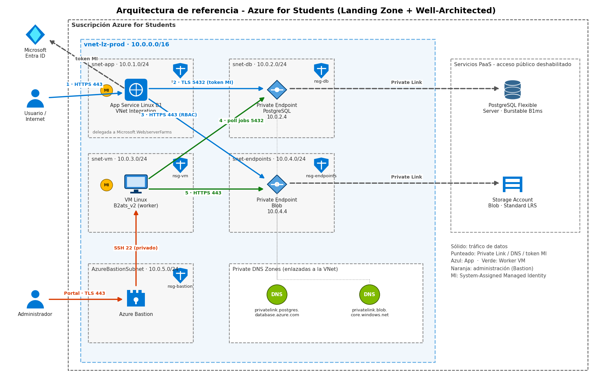

# Arquitectura del proyecto integrador – Azure (Lab 2)

Práctica 13 · PWA · IDGS 103 · UTVT
Implementación en el portal de Azure de la infraestructura del proyecto integrador, siguiendo los videos del **Lab 2** del repositorio [azure-laboratories](https://github.com/jorgealmeidamontiel/azure-laboratories/tree/main/Lab%202).

## Componentes creados

| # | Video del Lab 2 | Componente | Evidencia |
|---|---|---|---|
| 1 | Diagrama de infraestructura | Revisión del diagrama | [docs/arquitectura-azure-students.png](docs/arquitectura-azure-students.png) |
| 2 | Creación de VNet y Subnets | Red virtual y subredes | [01](evidencias/01-vnet-agregar-subred.png), [02](evidencias/02-vnet-implementada.png) |
| 3–5 | Máquina Virtual 1, 2 y 3 | VM Windows Server 2025 (B2als v2) + Bastion | [03](evidencias/03-vm-implementacion.png), [06](evidencias/06-vm-bastion.png), [07](evidencias/07-vm-ipconfig.png) |
| 6 | Azure Database for PostgreSQL | Servidor flexible Burstable B1ms | [08](evidencias/08-postgres-implementado.png), [09](evidencias/09-postgres-informacion.png) |
| 7 | Private Endpoint | Endpoint privado de PostgreSQL | [10](evidencias/10-pe-postgres-implementado.png), [11](evidencias/11-postgres-redes-pe.png) |
| 8 | Creación de una nueva BD | Base de datos `integradora` (Azure CLI) | [12](evidencias/12-bd-lista-inicial.png), [13](evidencias/13-bd-cloudshell-create.png), [14](evidencias/14-bd-integradora-creada.png) |
| 9 | Detener VM y servidor de BD | Ahorro de créditos | [15](evidencias/15-vm-deteniendo.png), [16](evidencias/16-vm-detenida.png), [17](evidencias/17-postgres-servidor.png) |
| 11 | Blob Storage | Cuenta de almacenamiento | [18](evidencias/18-storage-implementado.png) |
| 12 | Private Endpoint – Blob | Endpoint privado de Blob | [19](evidencias/19-pe-blob-validacion.png), [20](evidencias/20-pe-blob-implementado.png) |
| 13 | Nuevo App Service | Plan B1 Linux + Web App + Application Insights | [21](evidencias/21-appservice-informacion.png), [22](evidencias/22-appservice-ejecutandose.png), [23](evidencias/23-application-insights.png) |

Detalle de nombres y rangos: [docs/red-y-subredes.md](docs/red-y-subredes.md).

## Cambios respecto al laboratorio

La suscripción **Azure for Students** tiene una política que solo permite ciertas regiones (`RequestDisallowedByAzure`) y cuota limitada por familia de VM:

- **Mexico Central bloqueada** → todo se creó en **North Central US** ([evidencia](evidencias/00c-prueba-regiones.png), script [01-verificar-regiones.sh](scripts/01-verificar-regiones.sh)).
- **Tamaños de VM sin cuota** (D2s_v3, D2als_v6) y solicitud de aumento rechazada ([evidencia](evidencias/00b-cuota-rechazada.png)) → se usó **Standard B2als v2** (familia Basv2) ([script](scripts/02-verificar-cuotas-y-tamanos.sh)).
- **Nombres globales únicos** (PostgreSQL, Storage) → se agregó el sufijo `ajo` porque el nombre del ejemplo ya existía.
- La VM creó su propia red `vnet-northcentralus-1`; los Private Endpoints se conectaron a esa red para que la VM los alcance.

## Scripts (Azure Cloud Shell – Bash)

| Script | Uso |
|---|---|
| [scripts/01-verificar-regiones.sh](scripts/01-verificar-regiones.sh) | Prueba en qué regiones se puede desplegar |
| [scripts/02-verificar-cuotas-y-tamanos.sh](scripts/02-verificar-cuotas-y-tamanos.sh) | Familias con cuota y tamaños disponibles |
| [scripts/03-crear-base-de-datos.sh](scripts/03-crear-base-de-datos.sh) | Crea la BD `integradora` |
| [scripts/04-detener-recursos.sh](scripts/04-detener-recursos.sh) | Detiene VM y servidor de BD |
| [scripts/05-iniciar-recursos.sh](scripts/05-iniciar-recursos.sh) | Vuelve a encenderlos |

## Autor

[Tu nombre completo] · al222110829 · UTVT
